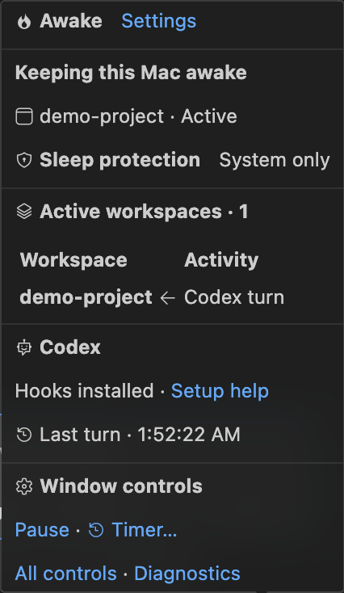
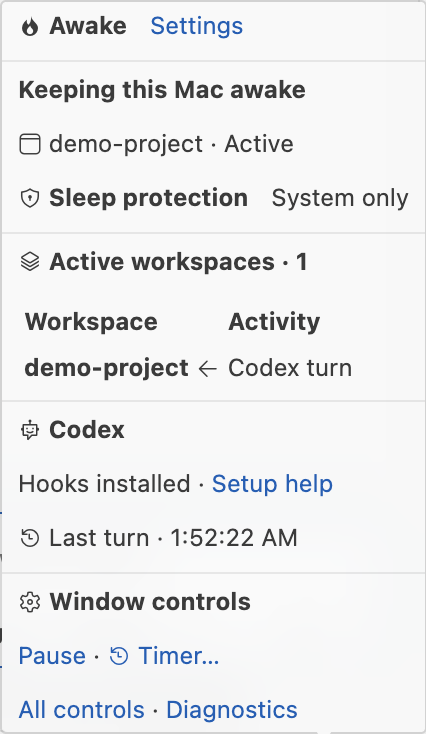

# Awake for Codex

Keep your Mac awake while Codex works in VS Code.

[Install the pre-release from Marketplace](https://marketplace.visualstudio.com/items?itemName=vinismoraes.awake-vscode)

This public repository contains support documentation, screenshots and issue
tracking only. Extension source is maintained in a separate private repository.
The initial release supports Apple Silicon macOS and local VS Code 1.140+.

## Setup

1. Install Awake and the Codex extension. Open a trusted workspace folder.
2. Approve the four **Awake: Codex activity** hooks in Codex.
3. Reload VS Code, then start a new turn in that workspace.

Awake installs hooks automatically; initial Codex approval is still required.
No separate Node.js installation is needed. Routine upgrades preserve the hook
commands. Use **Awake: Codex Setup Help** if setup is incomplete.

## What the flame means

A pulsing flame means an Awake window reports a sleep-prevention request.
Hover for the active workspace list. Pause affects only the current window.
Tasks, terminals and timers can keep Awake active after a Codex turn finishes.

The images are real VS Code captures from an isolated test workspace using
simulated lifecycle events, not a real user conversation.

## Troubleshooting

- Idle during Codex work: check hook approval, workspace trust and tracking;
  reload, then start a new turn within an open folder.
- Active after completion: inspect the hover for other tasks or timers. A lost
  completion event can leave a turn active for up to two hours; Pause overrides it.
- Another workspace active: its name appears in the hover. Each window owns
  its own power request; pausing one does not stop another.
- Setup error: use **Awake: Show Diagnostics** and **Awake: Set Up Codex**.
- No automatic update from a local VSIX: switch to the pre-release channel and
  enable Auto Update on the extension page.

## Remove

Run **Awake: Remove Codex Integration** before uninstalling. Uninstalling the
VSIX alone does not remove external hooks. Private backups/helper generations
remain locally. Reinstalling leaves a removed integration disabled until you
explicitly run **Awake: Set Up Codex**.

## Boundaries and privacy

Main Codex turns are supported; background subagents and Claude are not.
Intel Macs, remote windows, Windows, Linux and browser VS Code are not supported
by the current package. Keep the lid open: Awake does not override explicit sleep,
lock policy or authentication.

Awake has no telemetry or runtime network calls. It records local workspace paths,
times and optional process identity, not prompts or transcript text. Hook backups
can contain existing hook configuration. Review diagnostics before sharing.

## Report a problem

[Open an issue](https://github.com/vinismoraes/awake-support/issues/new/choose)
with versions, reproduction steps and expected/actual behavior. Never attach
credentials, hook backups or conversation text. For security concerns, start
with a minimal report requesting private contact; do not post exploit details
or sensitive data publicly.

Awake is an independent extension, not an OpenAI or Microsoft product.
